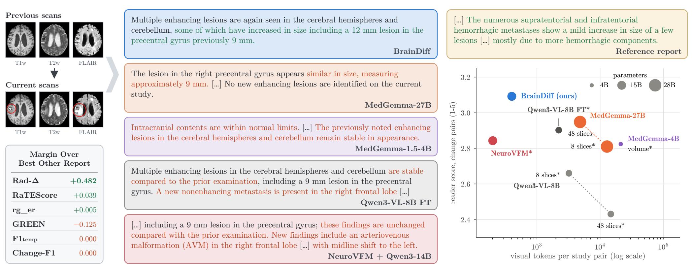

# BrainDiff

Longitudinal comparison-report generation for multimodal brain MRI. A prior and a current study of
the same patient (T1w, T1ce, T2w, FLAIR) plus the prior report go in, and a report describing what
changed between them comes out.

Built on NeuroVFM's vision stack, with blocks 10-12 of its encoder trained, a per-scan perceiver
connector and a Qwen3-14B decoder with LoRA, trained in two stages: Stage 1-D (change-status and
entity tasks), then status-first report generation. Source code for *Longitudinal Report
Generation for Multimodal Brain MRI: A Change-Focused Metric and Vision-Language System*.



*Left: a pair whose metastases grew. BrainDiff reports the increase; the other systems call the
lesions stable or report findings that are not there. Right: reader score on change pairs against
visual tokens per study pair.*

## Install

```bash
cd braindiff
pip install -e .
```

`flash-attn` must be built for your GPU architecture (it is imported unguarded by the NeuroVFM
ViT), and `neurovfm` ([github.com/mlinslab/neurovfm](https://github.com/mlinslab/neurovfm)) is
installed separately. RadGraph-XL pins `transformers<5` and runs in a separate environment from
the trainer; `requirements.txt` and `requirements-scoring.txt` are split for that reason.

**Rad-Δ, the change metric, is not part of this repository.** It is released separately as the
`raddelta` package and is needed for the change labels behind the Stage 1 targets
(`dataset/build_stage1.py`, `build_stage2.py`), for macro-MCC and change agreement
(`eval/score.py`) and for Fig. 2 (`eval/knows_says.py`). Everything else runs without it.

## Reproduce the paper's numbers (no GPU, no data)

```bash
cd braindiff
python paper/table2.py                # Table 2: rg_er and F1temp re-derived, 95% intervals, paired tests
python paper/figures/fig2_knows_says.py
python paper/figures/fig3_cost.py
pytest tests                          # Table 2 cells vs paper/table2_golden.json; cache holds no labels
```

These read the per-pair score cache in `paper/cache/`.

**What this repository does and does not support.** It supports *numeric* reproduction of the
cells that need no reference labels: every rg_er and F1temp point and interval in Table 2
re-derives from the shipped cache. Macro-MCC, change agreement and the reader scores need the
labels of the reference reports, so they are read from `table2_golden.json` and marked as such;
`paper/table2.py --full` recomputes every cell for anyone with the data. It does not support
*generative* reproduction without the data: BIND, MR-RATE and MIMIC-CXR are not redistributed.
See `docs/DATA_TERMS.md`.

## Layout

```
braindiff/
  src/braindiff/      the library
    models/           encoder, connector, decoder, prompts, Stage 1-D model, final model
    data/             volumes -> NeuroVFM tokens, Stage 1-D and Stage 2 datasets
    training/         train_stage1.py, train_stage2.py
    eval/             generation, scoring, F1temp, knows-vs-says (Fig. 2)
    configs/          stage1.yaml, stage2.yaml
  dataset/            BIND preprocessing, registration, QC and split; Stage 1 and Stage 2 builders
  baselines/          every Table 2 baseline; cxr/ = the MIMIC-CXR rows (MAIRA-2, Libra)
  paper/              Table 2, reader protocol, per-pair cache, figures
  scripts/            train.sh, test.sh, fetch_weights.py, strip_release_checkpoint.py
  tests/              the golden-file reproduction test
docs/                 data terms, reproduction, prompt changes
```

## Weights

`braindiff.pt` holds 429 tensors, about 115 M parameters, no optimizer state: NeuroVFM encoder
blocks 10-12 and final norm, the perceiver connector and the decoder LoRA.

```bash
huggingface-cli login          # both NeuroVFM repositories are gated; accept their terms
python scripts/fetch_weights.py            # or --release for just the BrainDiff checkpoint
```

The NeuroVFM backbone and the Qwen3-14B base are not in the checkpoint; they are downloaded from
their own repositories into the standard HuggingFace cache. See `MODEL_LICENSE`.

## Generation

```bash
torchrun --standalone --nproc_per_node=4 -m braindiff.eval.generate --ckpt braindiff.pt \
    --split test --repetition_penalty 1.1 --out out/gen_test.jsonl
```

The reported decode is greedy with an output-only repetition penalty of 1.1; the opening status
line is cut before scoring. Inputs are template-space volumes (193×229×193 at 1 mm) in the layout
`dataset/bind_preprocess.py` writes. Generation is not bitwise repeatable across processes
(`docs/REPRODUCTION.md`).

## Training

`docs/REPRODUCTION.md` has the full order, from BIND preprocessing to `scripts/train.sh` (Stage 1-D,
selection, Stage 2, selection). Training needs the data, which is not redistributable. One prompt
differs from the version used to build the training targets; see `docs/PROMPT_CHANGES.md`.

## Citation

```bibtex
@article{patel2026braindiff,
  title   = {Longitudinal Report Generation for Multimodal Brain MRI: A Change-Focused Metric and Vision-Language System},
  author  = {Patel, Krish and Liu, Peirong},
  journal = {arXiv preprint arXiv:2609.00593},
  year    = {2026},
  doi     = {10.48550/arXiv.2609.00593}
}
```

See also `CITATION.cff`.

## Intended use

A research artifact. **Not a medical device**, not validated for clinical use, and not to be
used to inform patient care.
